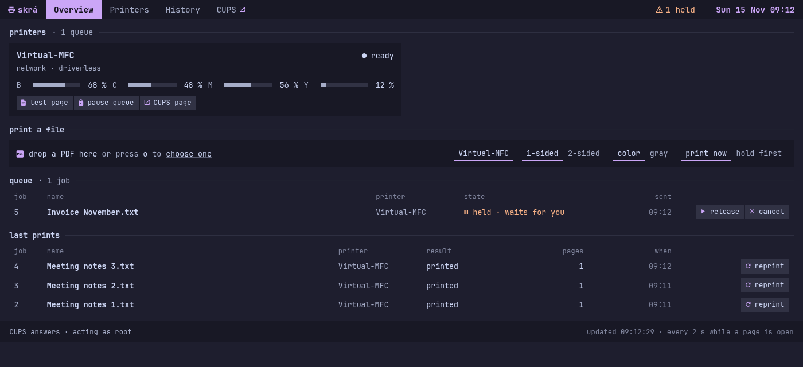
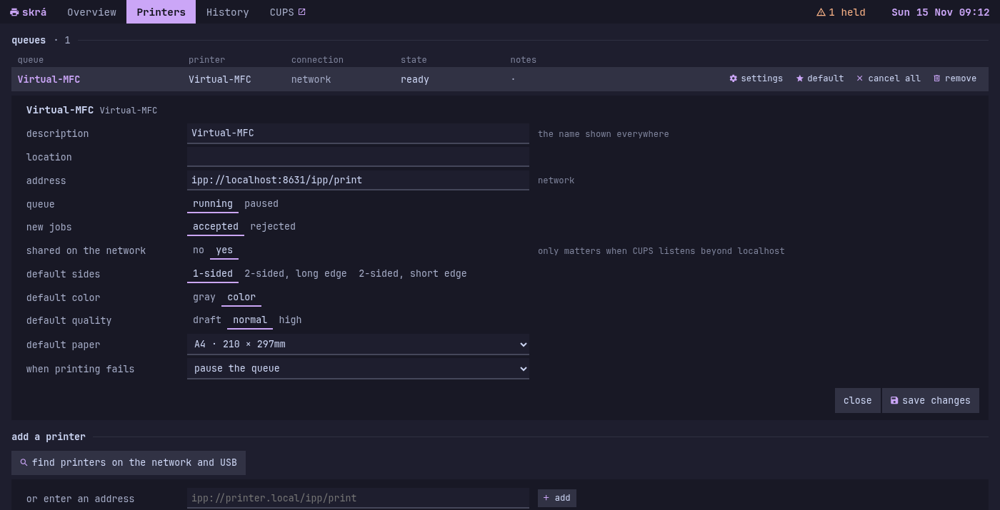
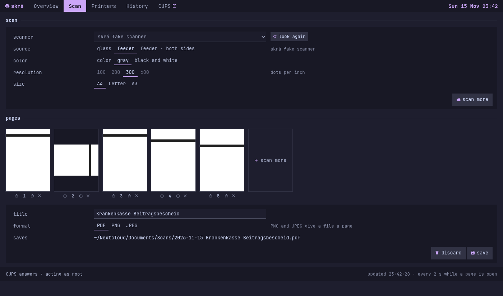

# skrá

[](LICENSE)

A small web service that replaces the CUPS web interface on a Linux laptop. It
shows your printers with live ink levels, prints a file you drop on the page,
manages the queue, adds and configures printers, reads the CUPS log, and scans
into a folder. It runs as your own user, listens on `127.0.0.1:7631` only, and
sleeps when nobody uses it: systemd starts it on the first request, and it
exits after five idle minutes.







## 🖨️ What it does

- **Overview:** each printer with its state and ink levels, a test page button,
  and printing a PDF, JPEG, PNG or text file by dropping it on the page. The
  page updates itself over Server-Sent Events while it is visible.
- **Queue:** hold, release, move to another printer and cancel your jobs.
  Canceling a job that is already printing asks first, and so does anything
  that destroys more than one job.
- **Printers:** find printers on the network and over USB, add one as a
  driverless queue or with a driver CUPS has, and remove one. A queue's
  settings cover description, location, address, paused or running, accepting
  jobs, sharing, default sides, color, quality and paper, and what to do when
  printing fails. Maintenance commands the printer offers, such as cleaning
  the print heads, sit beside them.
- **CUPS log:** the last lines of the `cups.service` journal, with a switch for
  debug logging.
- **Scan:** scan from the feeder or the glass, see each page, turn or drop
  it, scan more, and save the pages as one PDF or as a PNG or JPEG file per
  page. See [Scan](#-scan).
- **History:** the finished jobs CUPS keeps, each with a reprint button.

Every action is recorded with the user who did it, in a SQLite file under the
state directory.

## 📠 Scan

The Scan tab lists the scanners it knows: the ones in `scanners` in the
config, and the ones the network announces through avahi as eSCL scanners,
over http (`_uscan._tcp`) or https (`_uscans._tcp`). It asks a scanner
nothing until you open the tab. Pick the source (feeder, feeder on both
sides, or glass), the color mode, the resolution and the paper size from what
that scanner says it can do, then press scan.

Each page shows as it arrives. Turn a page left or right, or drop it, and
press scan more to add pages from the same scanner at the same resolution.
The save row shows the full path before anything is written, and it follows
the title as you type, for example
`~/Nextcloud/Documents/Scans/2026-11-14 Krankenkasse Beitragsbescheid.pdf`.
An empty title becomes the time of day. A save never overwrites a file: when
the name is taken, it adds ` (2)`. The saved files are mode `0600`.

Until you save or discard them, the pages wait in `scans/` under the state
directory. A scan you did not save, because you closed the page or skra
exited, shows at the top of the Scan tab the next time, with the time it
began and its pages, to continue or to discard.

To try it without a scanner, `make dev` starts a fake eSCL scanner on
`127.0.0.1:8632` and lists it as "skrá fake scanner". Its pages are white
sheets with one dark band. `dev/harness/README.md` shows how to make its
feeder run empty, jam or report busy.

## 📦 Install

You need Go, a running CUPS 2.4 and a systemd user session.

```sh
git clone https://github.com/nemesis398/skra.git
cd skra
make install-user
```

That builds the binary, copies it to `~/.local/bin/skra`, copies the two units
from `dist/` to `~/.config/systemd/user/`, and runs
`systemctl --user enable --now skra.socket`. Then open
<http://127.0.0.1:7631/>.

Only the socket is started. The service starts when the first request arrives,
exits after `idle_exit` without a request or an open page, and starts again
the next time you open the page. `make install-user` restarts a running
service so that it picks up a new binary.

To remove it, run `systemctl --user disable --now skra.socket skra.service`
and delete the three files.

## 🔑 CUPS rights

skra talks to CUPS over the local socket `/run/cups/cups.sock`, never over TCP.
Every request carries `Authorization: PeerCred <user>` and
`requesting-user-name <user>`. CUPS reads your user from the connection and
grants admin operations to members of `wheel` (or `lpadmin` or `sys` on other
distributions) without a password. skra asks for no password, holds none and
stores none, and the YubiKey step in a CUPS web login never comes into play.

The service adds no new rights: any program running as you can send the same
requests with `lpadmin` today. It adds a new door, and the door is guarded:

- It listens on `127.0.0.1` or `localhost` and refuses any other host in
  `listen`. Under socket activation it refuses to start on a socket that is
  not TCP on `127.0.0.1`, so a unit edited to `ListenStream=7631` fails
  instead of serving the network.
- Every request needs a `Host` of `127.0.0.1` or `localhost` with the port
  skra listens on (`7631` unless you change it), which stops DNS rebinding.
- Every request that changes something also needs the token in the
  `X-Skra-Token` header, and an `Origin` that is absent or the page's own.
  Anything else gets `403`. The token is 32 random bytes in `token` in the
  state directory, mode `0600`, so a page left open across an idle exit
  keeps working. skra refuses to start when that file is empty, short or
  open to the group or others; delete it, and the next start makes a new
  one.
- Another site may link to the tabs and do nothing else: any other
  request the browser marks as coming from another site gets `403`.
- No other page may frame skrá, and a page loads no script but skra's own
  (`Content-Security-Policy`).

## ⚙️ Configuration

No file is needed. To change a default, write `~/.config/skra/config.json`. An
unknown key is an error.

| Key | Default | Meaning |
| --- | --- | --- |
| `listen` | `127.0.0.1:7631` | `127.0.0.1` or `localhost`, on any port. Under socket activation the socket unit decides, and the `Host` check follows its port. |
| `cups_socket` | `/run/cups/cups.sock` | The CUPS socket. |
| `user` | `$USER` | The name sent to CUPS and recorded with every action. |
| `state_dir` | `~/.local/state/skra` | Where the action log, the token and the scans waiting to be saved live. |
| `idle_exit` | `5m` | How long the service waits with no request before it exits. Ignored when it was not started by its socket. |
| `declared_queues` | none | Queue names that your system configuration owns. They show as read-only and cannot be removed or re-addressed here. |
| `cupsd_conf_managed` | `false` | Set it when `cupsd.conf` is managed elsewhere, and the debug switch turns off. |
| `scan_folder` | `~/Nextcloud/Documents/Scans` | Where a scan is saved. An absolute path, or one that starts with `~/`. skra creates it on the first save. |
| `scanners` | none | Scanners to list before the ones the network announces, each as `{"name": "Brother", "url": "http://192.0.2.7/eSCL"}`: a name to show and the `http` or `https` address of its eSCL root. |

## 🧪 The harness

The tests never touch your real CUPS. `make harness-up` starts a rootless
Podman container with its own CUPS and a virtual IPP Everywhere printer, and
its socket appears at `.dev/run/cups.sock`.

```sh
make test          unit tests, no container needed
make integration   starts the harness, then runs every test against it
make dev           skra on 127.0.0.1:7631 against the harness, with the fake scanner
make harness-down  remove the container
```

`make dev` is how to look at the interface without a printer of your own. The
screenshots above come from it. `dev/harness/README.md` has the details.

## ⚡ Budgets

Each one is a test in `internal/web/budget_test.go`, run by `make integration`.

| Path | Budget | Measured against the harness |
| --- | --- | --- |
| Any page, server time | p95 under 50 ms | under 1 ms |
| A CUPS action (hold, release) | p95 under 150 ms | about 1 ms |
| Page, style and script together | under 200 KB | 54 KB |
| Resident memory, idle | under 50 MB | about 22 MB |
| Timers and polling with no page open | none | the idle timer only |

While a page is open, skra asks CUPS every 2 seconds and the printers
themselves every 5 seconds, and pushes only what changed. When the last page
closes or hides, all of that stops. The one timer left is the idle timer that
ends the process.

## ⚠️ Known limits

- **Ink levels are the printer's own, when it answers.** When it does not,
  skra shows CUPS's copy, which CUPS reads only while it prints, and says when
  that was.
- **History is what CUPS keeps.** skra lists the completed jobs CUPS still
  remembers, up to 200. It keeps no archive of its own.
- **The CUPS log needs journal access.** Reading it runs `journalctl`, which
  your user may not be allowed to do, and the section then says so.
- **Declarative systems.** On NixOS or another system that declares queues in
  its configuration, those queues come back after a rebuild. List them in
  `declared_queues` so skra shows them read-only.
- **Scans go to a folder.** Saving to Paperless, OCR and scan presets are not
  part of this version.
- **The scan folder needs hard links.** A save writes each file under a
  hidden name and then links it to its own, so it never overwrites a file.
  FAT and exFAT, and some network mounts, cannot link, and a save there
  fails. Point `scan_folder` at a folder on a Linux file system.
- **Saving a picture takes memory.** A page saved as PNG, or turned and
  saved as JPEG, is decoded and encoded again: about 110 MB at 600 dpi on
  A4, and twice that on A3. A PDF and an unturned JPEG are copied as the
  scanner sent them and take next to nothing. After a save, the memory goes
  back to the system. The unit caps the service at 256 MB
  (`MemoryMax=256M`).

## 📄 License

The code is licensed under [AGPL-3.0-or-later](LICENSE).
